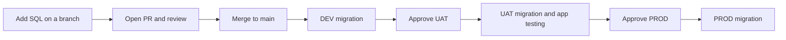

# PostgreSQL migrations with Liquibase

Deployment: [ci.yml](.github/workflows/ci.yml). Manual rollback: [rollback.yml](.github/workflows/rollback.yml). All Liquibase commands are directly in these workflows.

## Developer flow



1. Create a branch from the latest `main`.
2. Add `db/changes/003-add-customer-email.sql`:

   ```sql
   --liquibase formatted sql

   --changeset team:003-add-customer-email
   ALTER TABLE customers ADD COLUMN email VARCHAR(255);
   --rollback ALTER TABLE customers DROP COLUMN email;
   ```

3. Append it to `db/changelog.yaml`:

   ```yaml
     - include:
         file: changes/003-add-customer-email.sql
         relativeToChangelogFile: true
   ```

4. Push the branch, open a PR, and have the SQL reviewed. Merge to `main` to deploy DEV.
5. Check DEV in **Actions → Database migrations**, then approve UAT. Test the application in UAT before approving PROD.

Always add a new migration; do not edit or delete merged migrations. Use a unique filename and changeset ID. All three jobs check out the same commit. Liquibase tracks applied changes separately in each database and skips them on later updates. No application data is copied between databases.

## Commands in CI

Each environment runs these directly:

```bash
liquibase validate     # Check changelog structure and recorded checksums
liquibase update-sql   # Print pending SQL in the job log
liquibase tag --tag="before-RUN_ID-ATTEMPT"  # CI fills in the run ID and attempt
liquibase update       # Execute pending migrations against PostgreSQL
liquibase status       # Show any remaining changes
```

`update` is the migration command ([Liquibase documentation](https://docs.liquibase.com/community/reference-guide-5-0/init-update-and-rollback-commands/update)). A failed command stops the job and blocks the next environment. The SQL preview runs after the environment approval; reviewers can inspect the PR and the previous environment's logs before approving.

There are no test scripts or PR test jobs. SQL review happens in the PR, and database validation/application starts in DEV after merge. `validate` does not prove SQL correctness or test application behavior.

## One-time setup

- Use the dedicated Linux X64 runner labelled `liquibase-rds`, with network access to all three PostgreSQL databases.
- Install **Liquibase Community 5.0.4**, its supported Java runtime, and **PostgreSQL JDBC 42.7.14** on that runner. Put the JDBC JAR in Liquibase's `lib` directory and make `liquibase` available on the runner service's `PATH`. Check `java -version` and `liquibase --version` as the runner account. Keep the installed version unchanged during a release. See [Liquibase setup](https://www.liquibase.com/quickstart).
- Keep the readable AWS RDS CA bundle at `/opt/liquibase/certs/global-bundle.pem`. Download it from [AWS](https://truststore.pki.rds.amazonaws.com/global/global-bundle.pem). The workflow requires verified TLS.
- Have the DBA prepare each database and the `app` schema, owned by the migration account. The example migrations require a fresh schema; existing databases need a reviewed Liquibase baseline first.
- Create GitHub environments named `dev`, `uat`, and `prod`. In each, set the following values for that database:

  | Type | Name | Example |
  | --- | --- | --- |
  | Variable | `DB_HOST` | That environment's RDS endpoint |
  | Variable | `DB_NAME` | `appdb` |
  | Variable, optional | `DB_PORT` | `5432` |
  | Secret | `DB_USERNAME` | `app_migrator` |
  | Secret | `DB_PASSWORD` | That environment's password |

- Allow only `main` to deploy. Configure required reviewers for UAT and PROD **before merging**; otherwise those jobs run without approval. Your GitHub plan must support these environment rules.
- Protect `main` with required PR review. Replace the placeholder in `.github/CODEOWNERS` with your reviewer/team if using Code Owner review. Remove the old required `Migration checks` status from branch protection, since that test job no longer exists.

## Releases and failures

Finish one release before merging the next database PR. An active release is never automatically cancelled, but GitHub may replace an older pending run with a newer one; the newer commit includes all merged migrations.

If a migration fails, inspect the error and database state before rerunning. Earlier changes may already have committed. Fix applied changes with a new migration; coordinate recovery with the DBA. Rollback is manual and may lose data, so confirm backups before approving production changes. Do not rerun an older release after a newer one has deployed.


## Manual rollback (workflow dispatch)

If a problem appears after deployment, roll back the affected database through **Actions → Rollback database → Run workflow**:

1. Stop further merges/deployments. If the deployment run is waiting for UAT/PROD approval, cancel that run so rollback can acquire the shared concurrency slot. Cancel other queued deployments too; confirm no migration is still running before continuing.
2. Copy the `before-RUN_ID-ATTEMPT` rollback tag from the affected environment's deployment job summary.
3. Select branch **main**, choose **dev**, **uat**, or **prod**, paste the tag, and select **preview**. Approve the environment if prompted, then review the generated SQL in the job log.
4. Dispatch again with the same environment/tag and mode **apply**. UAT/PROD use their existing environment approval rules.
5. Verify the application and database afterward. Rollback affects only the selected database and does not promote to other environments.

The direct commands are:

```bash
liquibase rollback-sql --tag="$ROLLBACK_TAG"  # Preview
liquibase rollback --tag="$ROLLBACK_TAG"      # Execute
```

The tag marks the state immediately before that deployment attempt. Rollback undoes **all applied changes after that tag**, including newer releases if any have since run. Use the affected latest deployment's tag and review the preview; this is not selective removal of an older release. See [Liquibase rollback semantics](https://docs.liquibase.com/community/reference-guide-5-0/init-update-and-rollback-commands/rollback).

Each retry creates a new attempt tag. A retry tag covers only changes applied after that retry started, so inspect earlier attempts if the release partially failed. Liquibase tags the last history row; a later tag with no intervening migration can replace the earlier tag. If the requested tag no longer exists, rollback fails rather than guessing a boundary. Deployments made before tagging was introduced have no automatic rollback point.

Every affected SQL changeset needs working `--rollback` SQL. Rollback may drop data written since deployment; it is not a backup restore. There is no 5–10 minute deadline, but review data impact before applying.

Rolled-back changes become pending again. Do not simply rerun deployment or merge another change: `liquibase update` would reapply them. Resolve the faulty change and agree on the next release with the DBA first. Keep the deployed SQL files and rollback definitions available in `main` until recovery is complete.
