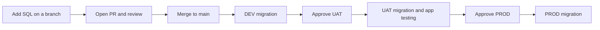

# PostgreSQL migrations with Liquibase

Database schema changes are version controlled in Git and deployed by CI. No schema change is made by a manual ALTER, CREATE, or DROP on dev, uat, or prod.

Deployment: [ci.yml](.github/workflows/ci.yml). Manual rollback: [rollback.yml](.github/workflows/rollback.yml). All Liquibase commands are directly in these workflows.

## Current state: Phase 1, proved end to end

Phase 1 is one database per Cloud SQL instance, with the same changelog on dev, uat, and prod. Phase 2, multiple databases in one instance, is not in this README yet. One Liquibase run manages exactly one database, with its own DATABASECHANGELOG history.

Applied migrations, in order:

| File | Change | Rollback |
| --- | --- | --- |
| `db/changes/001-create-customers.sql` | CREATE TABLE customers (id, name) | DROP TABLE customers |
| `db/changes/002-add-phone-number.sql` | ADD COLUMN phone_number VARCHAR(30) | DROP COLUMN phone_number |
| `db/changes/003-add-customer-email.sql` | ADD COLUMN email VARCHAR(255) | DROP COLUMN email |

Resulting table: `app.customers` with columns id, name, phone_number, email.

Branching strategy: GitHub Flow. `main` is the only long lived branch. Every change is a short lived feature branch, reviewed in a PR, and merged to `main`. CI runs only on push to `main`, so a feature branch alone deploys nothing. Promotion to uat and prod is by environment approval, not by another branch.

Release flow, in order: merge to `main`, DEV migration automatic, approve UAT, test the application in UAT, approve PROD, PROD migration. DEV is automatic. UAT and PROD are manual, through required reviewers on their GitHub environments. A failed job stops the chain. A job waiting for approval stays waiting until a reviewer approves, rejects, or cancels the run. It does not auto approve.

Rollback was tested on DEV. Rolled back changes become pending again, so they reapply on the next update unless the faulty change is resolved first. Rollback is schema only. It does not restore deleted data.

## Developer flow



1. Create a branch from the latest `main`.
2. Add a new file only, with the next number in order. Do not edit or delete a merged migration. Editing an applied changeset breaks Liquibase with a checksum error on the next run. Use one atomic change per file, a unique filename, and a unique changeset ID, and always include rollback SQL. Example for the next change:

   ```sql
   --liquibase formatted sql

   --changeset team:004-add-customer-status
   ALTER TABLE customers ADD COLUMN status VARCHAR(20);
   --rollback ALTER TABLE customers DROP COLUMN status;
   ```

3. Append it to `db/changelog.yaml`, in order:

   ```yaml
     - include:
         file: changes/004-add-customer-status.sql
         relativeToChangelogFile: true
   ```

4. Run `liquibase validate` and `liquibase update-sql` before review, and read the preview SQL. Do not run a manual update on prod.
5. Push the branch, open a PR, and have the SQL reviewed. Merge to `main` to deploy DEV.
6. Check DEV in **Actions, Database migrations**, then approve UAT. Test the application in UAT before approving PROD.

All three jobs check out the same commit. Liquibase tracks applied changes separately in each database and skips them on later updates. No application data is copied between databases.

## Commands in CI

Each environment runs these directly:

```bash
liquibase validate     # Check changelog structure and recorded checksums
liquibase update-sql   # Print pending SQL in the job log
liquibase tag --tag="before-RUN_ID-ATTEMPT"  # CI fills in the run ID and attempt
liquibase update       # Execute pending migrations against PostgreSQL
liquibase status       # Show any remaining changes
```

`update` is the migration command ([Liquibase documentation](https://docs.liquibase.com/community/reference-guide-5-0/init-update-and-rollback-commands/update)). A failed command stops the job and blocks the next environment. For UAT and PROD, the SQL preview runs inside the job, after the environment approval, so reviewers should inspect the PR and the previous environment logs before approving.

There are no PR test jobs yet. SQL review happens in the PR, and database validation and application testing start in DEV after merge. `validate` does not prove SQL correctness or test application behavior. Adding a PR validation job is a Phase 2 item, not a Phase 1 claim.

## Databases: GCP Cloud SQL, not AWS RDS

This setup uses GCP Cloud SQL, in GCP project `liqibase`, region `asia-south1` (Mumbai), PostgreSQL 18.6, Enterprise edition. There are three instances, named `dev`, `uat`, and `prod`, one per environment. Each instance is public IP enabled, private IP disabled, single zone, with automated backups and point in time recovery enabled.

Do not put hostnames, IP addresses, usernames, or passwords in this repo. The repo is public. All connection values live in GitHub environments, per environment, and are selected by the job `environment:` line in ci.yml and rollback.yml.

Per environment, in GitHub, set:

| Type | Name | Value |
| --- | --- | --- |
| Variable | `DB_HOST` | That environment Cloud SQL public IP, from its instance Overview page |
| Variable | `DB_NAME` | `appdb` |
| Variable, optional | `DB_PORT` | `5432` |
| Variable, optional | `DB_SCHEMA` | `app` |
| Secret | `DB_USERNAME` | `appuser` |
| Secret | `DB_PASSWORD` | That environment appuser password, different per environment |

Database, user, and schema, on all three instances: database `appdb`, owned by `appuser`; schema `app` inside `appdb`, owned by `appuser`; tables created by Liquibase as `appuser`, including `customers`, `DATABASECHANGELOG`, and `DATABASECHANGELOGLOCK`. The `postgres` database is only a bootstrap connection. Liquibase never targets it, and CI never uses the `postgres` master user.

Cloud SQL access is controlled by instance Authorized networks, in Cloud SQL, Connections, Networking, Authorized networks, not by VPC firewall rules. VPC firewall rules control Compute Engine VMs, not Cloud SQL.

## One-time setup

- Runner: dedicated Linux X64 VM, GCP instance `liquibase-runner-01`, region `asia-south1`, zone `asia-south1-a`, e2-medium (2 vCPU, 4 GB), Ubuntu 24.04 LTS, 20 GB balanced persistent boot disk. It is registered in GitHub as a self hosted runner with labels `self-hosted`, `Linux`, `X64`, `liquibase-rds`, with network access to all three Cloud SQL instances on port 5432. The runner must be online and Idle before a run, and stays online during the run.
- Install **Liquibase Community 5.0.4**, Java 17, and **PostgreSQL JDBC 42.7.14** on that runner. Put the JDBC JAR in Liquibase `lib` directory, at `/opt/liquibase/lib/postgresql-42.7.14.jar`, and make `liquibase` available on the runner service `PATH` at `/opt/liquibase`. Check `java -version` and `liquibase --version` as the runner account. Keep the installed version unchanged during a release. See [Liquibase setup](https://www.liquibase.com/quickstart).
- TLS, current lab setting: the workflows use `sslmode=require` with `currentSchema=app` (or the `DB_SCHEMA` variable). That encrypts the connection but does not verify server identity. There is no AWS RDS CA bundle in this setup, and no `global-bundle.pem` file is used. Moving to verified server CA or Cloud SQL Auth Proxy is a hardening item for production use, not a Phase 1 claim.
- Bootstrap each database and schema before CI can connect. CI does not create databases or users. Connect as `postgres` to the `postgres` database for that instance, then run, with a strong password per environment, never pasted in chat or in the repo:

  ```sql
  CREATE USER appuser WITH PASSWORD 'your-strong-password-here';
  GRANT appuser TO postgres;
  CREATE DATABASE appdb OWNER appuser;
  \c appdb
  CREATE SCHEMA app AUTHORIZATION appuser;
  \c postgres
  REVOKE appuser FROM postgres;
  ```

  The GRANT step is required on Cloud SQL, because its `postgres` user is a cloudsqlsuperuser, not a true superuser, and it cannot create an object owned by `appuser` until it is a member of `appuser`. The REVOKE step is cleanup. Ownership of `appdb` and schema `app` stays with `appuser`.
- Create GitHub environments named `dev`, `uat`, and `prod`, with the values in the table above. Allow only `main` to deploy. Configure required reviewers for UAT and PROD before merging; otherwise those jobs run without approval. Your GitHub plan must support these environment rules.
- Protect `main` with required PR review. CODEOWNERS for `db/` is set to `@vishutyagi0210`. Enable required Code Owner reviews in the main branch ruleset, so a DB change cannot merge without that review. Remove any old required `Migration checks` status from branch protection, since that test job no longer exists.

## Verify after a run

Run for each environment, as `appuser`, with that environment Cloud SQL IP:

```bash
PGSSLMODE=require psql -h <INSTANCE_IP> -p 5432 -U appuser -d appdb -c "\dt app.*"
PGSSLMODE=require psql -h <INSTANCE_IP> -p 5432 -U appuser -d appdb -c "SELECT id, author, filename, dateexecuted, exectype FROM app.databasechangelog ORDER BY dateexecuted;"
PGSSLMODE=require psql -h <INSTANCE_IP> -p 5432 -U appuser -d appdb -c "SELECT column_name, data_type FROM information_schema.columns WHERE table_schema = 'app' AND table_name = 'customers' ORDER BY ordinal_position;"
PGSSLMODE=require psql -h <INSTANCE_IP> -p 5432 -U appuser -d appdb -c "SELECT * FROM app.databasechangeloglock;"
```

Expected: `app.customers`, `app.databasechangelog`, and `app.databasechangeloglock` owned by `appuser`; changelog rows for 001, 002, and 003, all EXECUTED; customers columns id, name, phone_number, email; changelog lock not held. In Actions, the final `Show pending changes` step should show no pending changes.

## Releases and failures

Finish one release before merging the next database PR. An active release is never automatically cancelled, but GitHub may replace an older pending run with a newer one; the newer commit includes all merged migrations.

If a migration fails, inspect the error and database state before rerunning. Earlier changes may already have committed. Fix applied changes with a new migration; coordinate recovery with the DBA. Rollback is manual and may lose data, so confirm backups before approving production changes. Do not rerun an older release after a newer one has deployed.

## Manual rollback (workflow dispatch)

If a problem appears after deployment, roll back the affected database through **Actions, Rollback database, Run workflow**:

1. Stop further merges and deployments. If the deployment run is waiting for UAT or PROD approval, cancel that run so rollback can acquire the shared concurrency slot. Cancel other queued deployments too; confirm no migration is still running before continuing.
2. Copy the `before-RUN_ID-ATTEMPT` rollback tag from the affected environment deployment job summary.
3. Select branch **main**, choose **dev**, **uat**, or **prod**, paste the tag, and select **preview**. Approve the environment if prompted, then review the generated SQL in the job log.
4. Dispatch again with the same environment and tag and mode **apply**. UAT and PROD use their existing environment approval rules.
5. Verify the application and database afterward. Rollback affects only the selected database and does not promote to other environments.

The direct commands are:

```bash
liquibase rollback-sql --tag="$ROLLBACK_TAG"  # Preview
liquibase rollback --tag="$ROLLBACK_TAG"      # Execute
```

The tag marks the state immediately before that deployment attempt. Rollback undoes **all applied changes after that tag**, including newer releases if any have since run. Use the affected latest deployment tag and review the preview; this is not selective removal of an older release. See [Liquibase rollback semantics](https://docs.liquibase.com/community/reference-guide-5-0/init-update-and-rollback-commands/rollback).

Each retry creates a new attempt tag. A retry tag covers only changes applied after that retry started, so inspect earlier attempts if the release partially failed. Liquibase tags the last history row; a later tag with no intervening migration can replace the earlier tag. If the requested tag no longer exists, rollback fails rather than guessing a boundary. Deployments made before tagging was introduced have no automatic rollback point.

Every affected SQL changeset needs working `--rollback` SQL. Rollback may drop data written since deployment; it is not a backup restore. Review data impact before applying.

Rolled back changes become pending again. Do not simply rerun deployment or merge another change without agreeing the next release first: `liquibase update` would reapply them. Resolve the faulty change and agree on the next release with the DBA first. Keep the deployed SQL files and rollback definitions available in `main` until recovery is complete.

## Lab limitations and next steps for production use

These are lab settings in Phase 1, not final production claims:

- TLS is `sslmode=require`, not verified server identity. Next step: verified Cloud SQL server CA, or Cloud SQL Auth Proxy.
- Authorized networks were opened broadly in the lab so the runner could connect regardless of IP. Next step: replace any open range with the runner static IP, VPC private IP, or Auth Proxy before any real prod use.
- No PR test job yet. Next step: validate and update-sql on PRs, against a throwaway database, so bad SQL is caught before merge to `main`.
- Branch protection and required Code Owner review must be confirmed in GitHub Settings. The CODEOWNERS file alone does not block a merge.
- Costs, lab estimates at setup: about 0.17 USD per hour per Cloud SQL instance, and about 31.78 USD per month for the runner VM. Stop the runner VM when idle, and review backups, point in time recovery, and deletion protection per environment before prod use.
